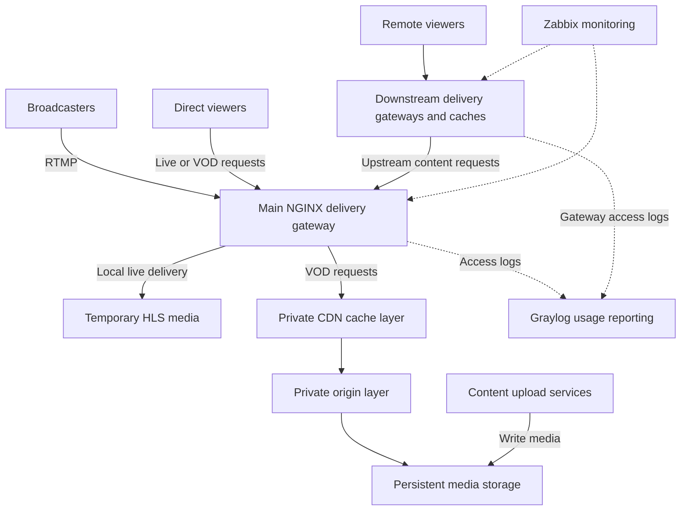

# IP-001 — Multi-Site Live Streaming and VOD Delivery Infrastructure

**Project type:** Anonymized production architecture case study

A Linux-based media delivery infrastructure combining live streaming, on-demand video, distributed CDN caching, resilient network routing, centralized monitoring and usage analytics.

## Challenge

Deliver centrally hosted media to viewers and downstream delivery environments without unnecessary repeated upstream retrieval. Maintain visibility into infrastructure health and customer content usage, and provide alternate network paths when inter-site connectivity fails.

## My contribution

I designed, implemented and maintained the NGINX-based streaming infrastructure, including downstream CDN deployments. My work encompassed Linux infrastructure, routing, monitoring, usage reporting and troubleshooting. A separate team handled video encoding; encoding software development and the content administration application's development are not claimed here.

## Architecture at a glance

Logical overview only. Request, upload and monitoring flows are distinguished by labels; inter-site network forwarding is abstracted. See [detailed architecture and content flows](architecture.md).

| Layer | Technologies and responsibilities |
| --- | --- |
| Live delivery | NGINX RTMP, HLS packaging, temporary local media |
| VOD delivery | NGINX load balancing, caching and origin services |
| Content ingestion | SFTP and administration web application |
| Storage | Persistent media storage and NFS |
| Distributed delivery | Downstream disk caches and local delivery gateways |
| Network | OSPF and redundant inter-site connectivity |
| Usage analytics | Tagged NGINX logs and Graylog pipelines |
| Monitoring | Zabbix infrastructure and service checks |
| Notifications | Telegram alerts and monthly usage reports |

## Engineering decisions

| Decision | Rationale |
| --- | --- |
| Separate live media from persistent VOD storage | Short-lived live segments do not require long-term storage. |
| Use a private cache and origin tier | Keep backend delivery services separate from externally accessible entry points. |
| Cache content in downstream environments | Reuse locally stored content instead of repeatedly retrieving it upstream. |
| Divide gateway roles during normal operation | Separate viewer-facing load balancing and upstream network forwarding, with mutual takeover designed for gateway failure. |
| Use OSPF across redundant inter-site paths | Respond to route failures even when local Ethernet remains up. |
| Aggregate access logs by content path and domain | Provide customer-oriented usage reporting without implementing billing. |
| Monitor infrastructure and service endpoints centrally | Cover both system health and application availability. |

## Engineering scope and limitations

The design addresses network path failures, gateway redundancy, storage dependencies and operational visibility. Network convergence does not guarantee seamless video playback. No system-wide high availability or measured performance is claimed.

- [Reliability and limitations](reliability.md)
- [Monitoring and usage reporting](observability.md)

## Evidence and disclosure

This case study documents first-hand professional experience as described by its author. The documentation was checked for consistency with that account; production configurations, runtime behavior and performance were not independently audited or tested. The diagrams are generalized and omit addresses, exact node counts, customer identities, security rules and proprietary configurations.

No measured cache hit ratios, availability percentages, convergence times or customer outcomes are asserted. Detailed configuration examples and failure tests may be published separately using synthetic lab environments.
