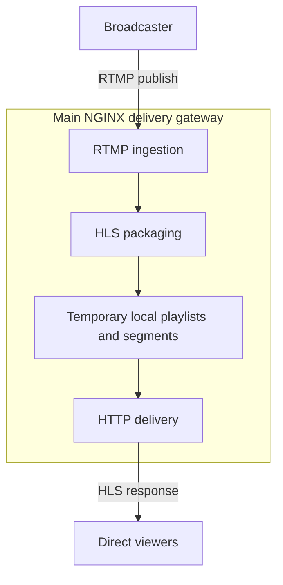
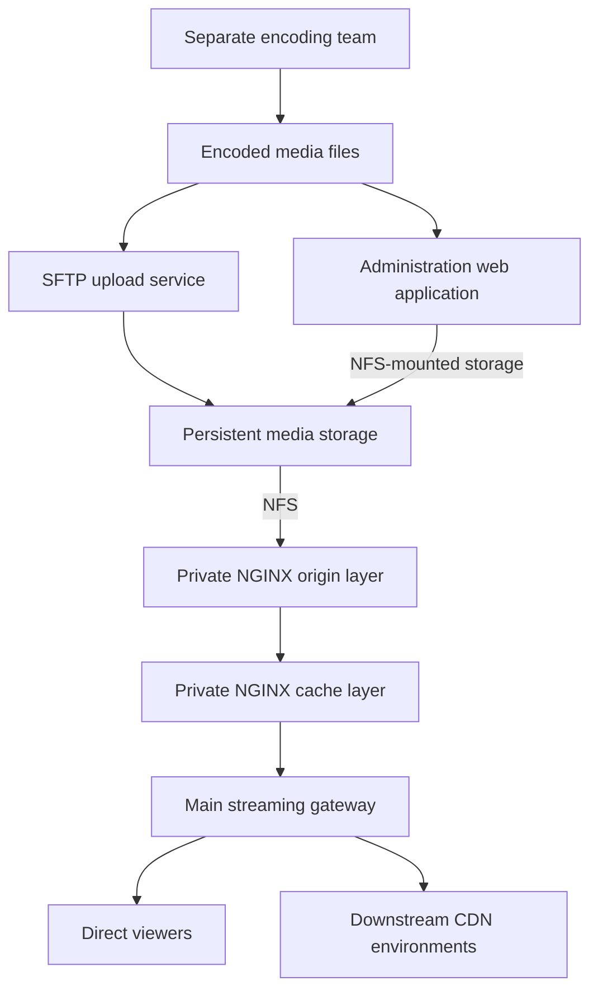
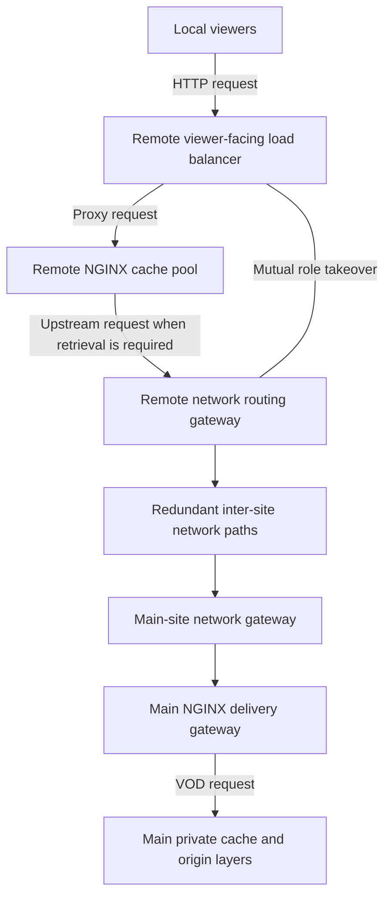

# Architecture and content flows

These generalized logical diagrams describe the reported architecture, not its physical deployment map. Production addresses, node counts and connection details are intentionally omitted.

## Live streaming

RTMP ingestion, HLS packaging, temporary local storage and HTTP delivery are on the same main gateway. Long-term live recording is outside the scope. HLS packaging is not a claim of video transcoding.

## VOD ingestion and delivery

This diagram shows content movement rather than HTTP request direction. Media encoding is performed separately. Content is uploaded via SFTP or an administration application with access to mounted media storage. The main VOD cache and origin layers are private; required delivery and upload services are externally accessible.

## Distributed CDN request routing

The remote cache nodes use the main NGINX delivery gateway as their upstream content endpoint, not the main origin or storage servers. The remote upstream gateway performs network forwarding; it is not depicted as an additional HTTP proxy. On a usable cache hit, the remote cache returns content through the viewer-facing load balancer without retrieving it again from the main site.

Some downstream environments also deliver their own uploaded content. Their local origin and upload topology is omitted.

## Routing boundary

OSPF runs among participating remote routing nodes and the main-site network gateway. Main-site servers use static default routes. Local main-site cache and origin traffic does not depend on inter-site dynamic routing.

The exact failover mechanism and protocol settings are outside the scope of these logical diagrams.
