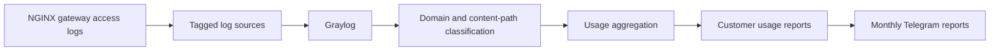
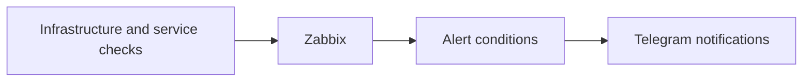

# Monitoring and usage reporting

## Usage reporting

Access logs from delivery gateways are forwarded with tags. Graylog pipelines and groupings classify data by domain and URL subdirectory to produce reports containing viewer-related metrics and transferred data volumes (GB or TB).

These reports support customer charging decisions; the reporting system does not itself perform billing or payment processing. The viewer identity method, handling of repeated requests and byte-counting accuracy have not been independently validated. No claim of exact unique-viewer counts is made.

## Monitoring

Zabbix monitors physical servers, availability, CPU, memory, disk, network utilization, physical link status, services and URLs. Telegram delivers operational alerts.

Actual customer logs, addresses, access tokens, notification destinations and operational thresholds are intentionally excluded.
